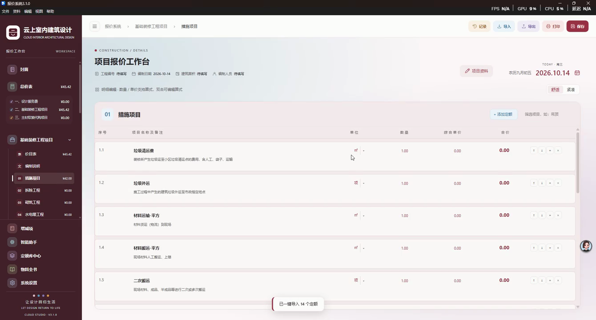
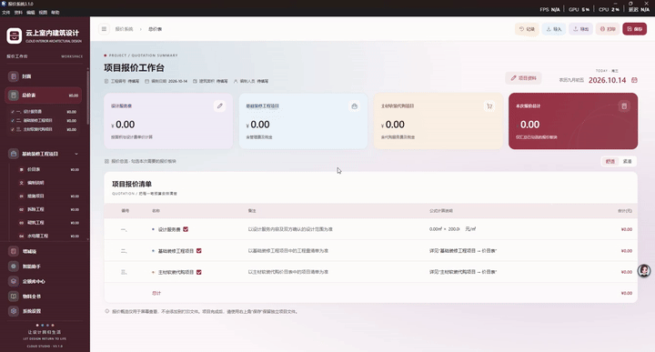

# 云数装企 · 报价系统 v1.0

> 基于小红书创作者「溜小溜」演示视频逐帧还原的网页版报价工作台原型。
> 单文件 HTML · 零依赖 · 双击即用 · 11 个功能模块 · 6 主题色 · 打印预览




## 🎬 演示动画(xhs 原视频前 8 秒)



## 🎯 这是什么

## 🎯 这是什么

一个面向 **室内装饰设计师** 的报价工作台 SaaS,用于:

- 制作全案设计施工报价书
- 分模块管理基础装修(措施/拆除/砌筑/水电暖/防水/保温/泥瓦/木作)
- 管理主材软装代购项目
- 跟踪增减项(Change Orders)
- 维护定额库(报价模板库)
- 一键打印导出 PDF
- 团队品牌克隆(导出/导入工作室配置 ZIP)

## 📂 文件结构

```
xhs-quote-app/
├── index.html              # 🌟 主产品(单文件 HTML,~1500 行)
├── xhs-source.mp4          # 原始小红书视频(3:22, 6.19MB, 720p)
├── frames/                 # 原 EV 录屏 92 帧(f001-f092.jpg, 3s/帧)
├── frames-xhs/             # xhs 原视频 68 帧(f001-f068.jpg, 3s/帧)
├── xhs-audio.mp3           # 提取的音频(16kHz mono, 793KB)
├── xhs-transcript.txt      # faster-whisper small 转录(仅结尾 4s CTA)
└── xhs-transcript-large.txt# faster-whisper large-v3 转录(0 段, 确认无旁白)
```

## 🚀 快速开始

1. 双击 `index.html`
2. Chrome / Edge / Safari 任一现代浏览器
3. 不需要服务器 / 任何依赖

## 🎨 核心特性

### 11 个功能模块(左侧导航)

| 模块 | 说明 |
|------|------|
| 封面 | 项目封面图 + 工程信息 |
| 总价表 | 4 个汇总卡片(¥310.39 示例) |
| 基础装修工程项目 | 8 个子项(措施/拆除/砌筑/水电暖/防水/保温/泥瓦/木作) |
| 主材软装代购项目 | 2 个子项(套装/石材) |
| 增减项 | Change Orders 管理 |
| 智能助手 | AI 助手入口 |
| 定额库中心 | 177 项基础定额 + 11 分类 |
| 物料全书 | 物料详情 + 20 种建材库 |
| 系统设置 | 7 个配置 tab |

### 7 个系统设置 Tab

| Tab | 功能 |
|-----|------|
| 项目资料 | 工程名称/编号/建筑师/编制人员 |
| 公司信息 | 公司名/Logo/封面 Logo 大小 |
| 费率设置 | 设计服务单价/管理费/税率/代购费 |
| 界面设置 | **6 主题色** + 3 模式 |
| 水印设置 | 文字/图片水印 + 实时预览 |
| 打印设置 | 页眉抬头 + 4 个显示勾选 |
| 克隆设置 | 导出/导入 ZIP 工作室配置 |

### 6 主题色

- **胭脂** (#B50029 — 默认)
- **黛青** (#2a4858)
- **松石绿** (#2d6e54)
- **赭石** (#8B4513)
- **烟紫** (#6b4a7a)
- **暖香** (#b8945a)

### 键盘快捷键

- `Ctrl+P` / `⌘P` — 打开打印预览
- `Ctrl+K` / `⌘K` — **打开命令面板**(24 个真实命令,可搜索)
- `1-8` — 数字键快速跳转主模块
- `M` — 打开物料全书弹窗
- `T` — 循环切换主题色
- `?` — 打开快捷键面板
- `Esc` — 关闭所有弹窗

### 🎁 额外功能

- **3 个示例项目切换**(header 右上 "📁"):新建空工程 / 进行中 ST-001 / 已完成 ST-002
- **导出报价书为独立 HTML**("↓ 导出报价书"按钮)— 可邮件/微信分享给客户
- **Cmd+K 命令面板**(类似 VSCode):24 个命令真实可执行
- **Changelog 弹窗**(点击 footer 版本号 `V1.0`)
- **浮动 Help 按钮**(右下角 `?`)
- **localStorage 持久化**(项目选择刷新不丢失)
- **打印预览弹窗**(6 页 A4 PDF + 实时水印预览)

## 🔧 技术栈

- **vanilla JavaScript** — 无框架,无依赖,无构建
- **CSS Grid + Flexbox** — 现代布局
- **CSS Custom Properties** — 6 主题色实时切换
- 单文件 ~1500 行,加载 < 100ms

## 📐 还原度对照(基于 xhs 原视频)

| 视频帧 | 还原模块 |
|--------|----------|
| 封面 | ✅ 项目封面 + 工程信息 |
| 总价表 | ✅ 4 卡片 + 项目报价清单 |
| 基础装修价目表 | ✅ 8 子项 + 小计 |
| 01 措施项目 | ✅ 安全/冬雨季/脚手架 |
| 02 拆除工程 | ✅ 空状态 + 添加按钮 |
| 03 砌筑工程 | ✅ 空状态 + 添加按钮 |
| 06 保温隔热 | ✅ 已填示例(落水管 ¥125 + 天棚 ¥120) |
| 增减项 | ✅ 增项/减项/净增减 + 5 行明细 |
| 定额库中心 | ✅ 177 项 + 11 分类侧栏 |
| 系统设置 · 费率 | ✅ 4 个费率字段 |
| 系统设置 · 界面 | ✅ 6 主题色 + 3 模式 |
| 系统设置 · 水印 | ✅ 实时预览水印 |
| 系统设置 · 打印 | ✅ 页眉抬头 + 4 勾选 |
| 系统设置 · 克隆 | ✅ 导出/导入 ZIP |
| 公司信息 | ✅ Logo + 封面 Logo 大小 |
| 物料全书弹窗 | ✅ 20 种建材卡片 |
| 打印预览弹窗 | ✅ 6 页 PDF + A4 预览 + 水印 |

## 🛠️ 制作过程

1. **下载原视频** — `yt-dlp` 抓小红书原视频(3:22 / 720p)
2. **抽帧分析** — `ffmpeg` 每 3 秒抽 1 帧(共 68 帧)
3. **视觉分析** — 阅读 28 张关键帧识别 11 个功能模块
4. **音频验证** — `faster-whisper small + large-v3` 双跑,确认视频无旁白
5. **产品还原** — 单文件 HTML,vanilla JS,1500 行

## 📝 License

MIT — 个人演示项目

---

Made with ❤️ by 云上 Studio · 2026-10-15