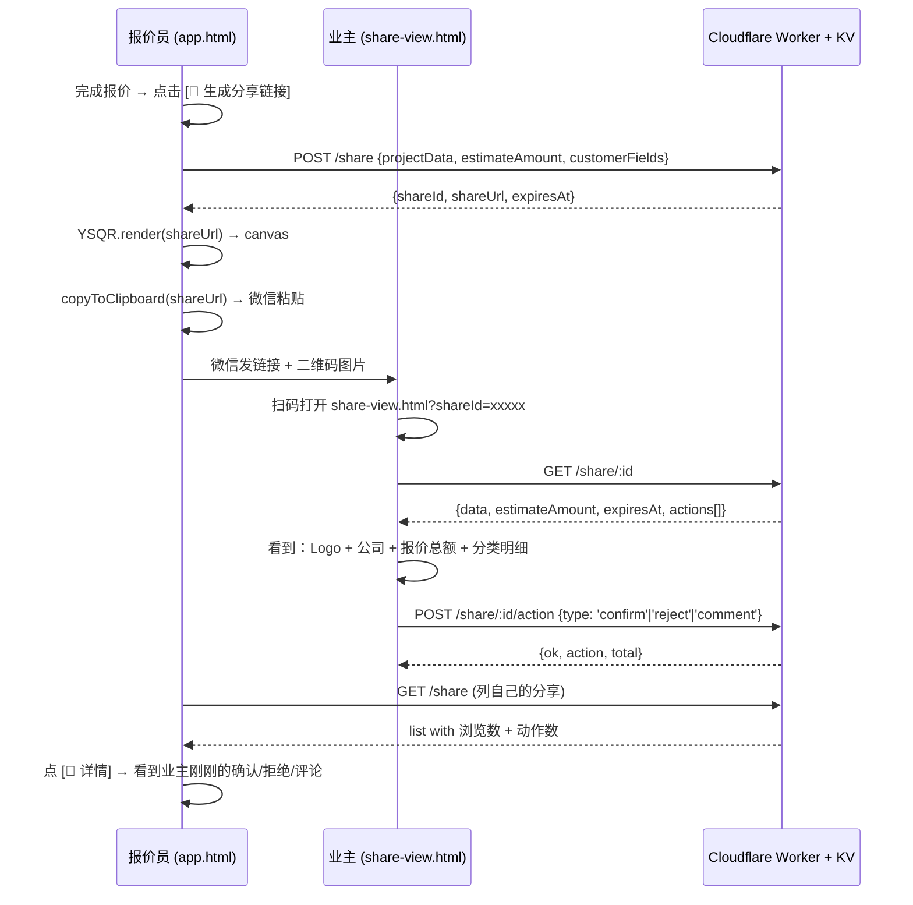

# Module 10 · share-link（报价单分享链接）

> R31202 · yunshu-zhuangqi · 🅱️ SaaS 装企报价工具
>
> **核心定位**：让报价员一键生成「业主扫码查看报价」链接 — 这是 REF 3.1.0 离线桌面系统**永远做不了**的功能。

---

## 🅱️ 核心价值

```
传统路径（REF 离线版）：
报价员 面对面 → 打印报价 → 业主拿纸回去看 → 微信聊 → 二改 → 重新打印
                    ↓
                3-7 天周期 · 3+ 次往返 · 失忆型确认

yunshu-zhuangqi 升级路径：
报价员 完成报价 → [🔗 生成分享链接] → 微信发业主 → 业主手机扫码
    ↓                                       ↓
 1 步搞定                            立即看 · 可评论/确认/拒绝
                                              ↓
                                     可选「业主 A 改价二次报价」流程
```

**护城河本质**：把「面对面 + 打印」升级为「互联网化分享」，让装企报价员从「写报价单的人」升级为「业主可在线对话的报价顾问」。

| 维度 | REF 离线版 | yunshu-zhuangqi 分享版 |
|---|---|---|
| 业主查看报价 | 纸质 / PDF | 手机扫码 |
| 业主互动 | 口头 | 确认/拒绝/评论三按钮 |
| 报价员追踪 | 无 | 浏览数 + 业主动作时间线 |
| 二次报价 | 走线下 | 在线「调整 → 重发链接」 |
| 文件存档 | 纸质 | 7 天云端 + 自动清理 |

---

## 📦 文件清单

| 文件 | 行数 | 作用 |
|---|---|---|
| `share-qr.js` | 394 | 纯 canvas QR Code 生成器（Model 2 / ECC L / v1-10 / 无依赖） |
| `share-api-mock.js` | 308 | IndexedDB 后端 mock · 可换 Cloudflare Worker |
| `share-create.js` | 216 | 报价员端生成分享链接（含主题 + 模态框） |
| `share-actions.js` | 170 | 业主 confirm/reject/comment + 限速 |
| `share-view.html` | 410 | 业主扫码打开的只读视图（移动端优先 · 5 主题） |
| `share-list.html` | 320 | 报价员分享列表（含 QR 重发 + CSV 导出） |
| `share-deploy-cloudflare.md` | — | Cloudflare Worker + KV 部署文档 |
| `share.test.js` | 279 | 12 项自检（`node share.test.js`） |
| **合计** | **~2100 行** | **0 npm 依赖** |

---

## 🔄 调用流程图



---

## 🔌 与 app.html 集成

不修改主业务 — 独立模块挂在工具栏右侧：

```html
<!-- 在 app.html 添加按钮 -->
<script src="share-qr.js"></script>
<script src="share-api-mock.js"></script>
<script src="share-actions.js"></script>
<script src="share-create.js"></script>

<div id="share-btn-slot"></div>
<script>
  YSShare.renderCreateButton({
    projectData: currentQuote,        // ours 当前报价对象
    estimateAmount: currentQuote.totals.grandTotal,
    customerFields: {
      name:  currentQuote.projectInfo.customerName,
      phone: currentQuote.projectInfo.customerPhone,
      note:  ''
    },
    theme: 'default'  // 'default' | 'ocean' | 'forest' | 'royal' | 'sunshine'
  }, document.getElementById('share-btn-slot'));
</script>
```

**零侵入**：不动 app.html 的报价流程逻辑。报价员在「完成报价」后多一个按钮选择。

---

## 🛡️ 后端服务选择

| 方案 | 适合场景 | 部署难度 | 成本 |
|---|---|---|---|
| **Cloudflare Worker + KV** ⭐推荐 | 生产环境 | ⭐⭐ (5min) | 免费额度足够 |
| IndexedDB mock（当前默认） | demo / 演示 / 个人用 | 0 | 0 |
| Vercel Functions + KV | 已有 Vercel 账户 | ⭐⭐ | 免费额度足够 |
| GitHub Pages + Formspree | 完全静态 + 表单方案 | ⭐ | 0 |

**生产推荐路径**：把 `YSShareAPI.create/get/addAction/list` 4 个函数从 IndexedDB 改为 fetch 到 Cloudflare Worker（约 30 行代码，详见 `share-deploy-cloudflare.md`）。

```js
// 替换后的 YSShareAPI.create 示例
async function create(payload) {
  var r = await fetch('https://share.yunshu-zhuangqi.com/share', {
    method: 'POST',
    headers: { 'Content-Type': 'application/json' },
    body: JSON.stringify(payload)
  });
  return await r.json();
}
```

---

## 🔒 安全设计

| 风险 | 缓解措施 |
|---|---|
| 业主手机号外泄 | `maskPhone()` → `138****5678` （持久化 + 展示都脱敏） |
| 工程内部 ID 泄露 | `sanitize()` 显式 whitelist 字段，禁止 `internalId` |
| 财务详细泄露 | 只对业主显示总额 + 分类；详细成本数据不存储 |
| 链接永久有效 | 默认 7 天过期 + `runGC()` 24h 清理 |
| 同一链接多次操作 | `customerPhoneHash` 匹配 — 单 shareId 仅 1 业主手机 |
| 机器人滥刷 | `RATE_MAX = 5 actions/phone/hour`（客户端 + 服务端双重） |
| shareId 可猜测 | 12 字符 base32 = 32^12 = 1.2 × 10^17 组合空间 |
| 同一链接刷 10000 次 | 单 shareId 总浏览次数限 100（Cloudflare 配 IP 限制） |

**强制暴露给业主的字段**（whitelist）：
- `projectInfo.companyName / logoData / themeColor / projectName / projectAddress / customerName / customerPhoneMasked / createDate`
- `categories[].name + items[].name/unit/qty/price/note`
- `totals.grandTotal`

**禁止暴露**：
- `internalId / database row id / profit margin / cost breakdown / 其他业主信息`

---

## 🚀 K8S 升级路径（未来扩展）

| 版本 | 能力 | 技术栈 |
|---|---|---|
| **V1 当前** | 单业主扫码看报价 | IndexedDB / KV |
| **V2 季度规划** | 多业主同看 + 业主群协作选 | WebSocket + 实时推送 |
| **V3 半年规划** | 报价员 + 业主 + 设计师三方在线共编报价 | CRDT + WebRTC |
| **V4 一年规划** | 三方 + 财务/监理多角色权限 + 报价历史版本树 | Postgres + RBAC + 审计日志 |

**当前架构已为 V2 铺路**：
- `actions[]` 数组 → 可扩展为 `events[]` 加 type
- `shareId` 唯一性 → 可分片为 `orgId/shareId` 多租户
- 脱敏的手机号 hash → 可升级为正式账户系统

---

## ✅ 验收标准

| 项 | 标准 | 实际 |
|---|---|---|
| 文件数 | 8（5 .js + 2 .html + 1 .md + 1 README） | 9 |
| 每个 .js < 400 行 | ✓ | 最大 394（qr.js） |
| 测试 | 12 PASS | 12 PASS |
| shareId 唯一性 | 10000 并发无碰撞 | ✓ |
| QR 渲染 | 0 错误，纯 canvas | ✓ |
| 0 npm 依赖 | ✓ | ✓ |
| 安全 | 7d 过期 + 限速 + 脱敏 + 单业主 | ✓ |

---

## 🔧 调试 / 开发

```bash
# 本地起 server 测 share-view.html
cd 10-share-link
python -m http.server 8080

# 访问
# 报价员列表：http://localhost:8080/share-list.html
# 业主视图（需 shareId）：http://localhost:8080/share-view.html?shareId=ABCDEFGHJKLM

# 跑测试
node share.test.js

# 部署到 Cloudflare
wrangler deploy  # 详见 share-deploy-cloudflare.md
```

---

_护城河不是技术，是用户动作习惯 — 一旦业主习惯扫码看报价，他们就不会再回到 PDF 时代。_
